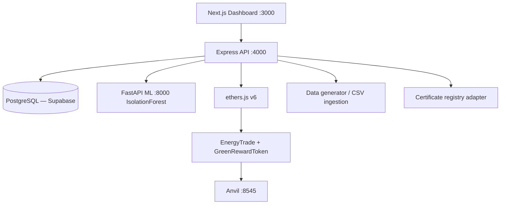

# Tranergy AI

**AI-assisted renewable-energy verification and microgrid coordination**

Tranergy AI connects trustworthy energy evidence to energy-market decisions: it checks renewable-energy certificate records against a registry adapter, flags suspicious meter data with deterministic rules + ML, estimates energy available for allocation, coordinates trades between facilities, and records trade/settlement events on a local EVM chain.

## What it does (end to end)

1. **Evidence & claim verification** — ingest meter readings (CSV import or the built-in data generator), run schema/continuity/duplicate/staleness/capacity/energy-balance rules, check certificate status against the registry adapter (ACTIVE / TRANSFERRED / RETIRED / INVALID / UNKNOWN / duplicate-use), score the interval with an Isolation Forest, and assign `VERIFIED_FOR_PROTOTYPE`, `REVIEW_REQUIRED`, or `REJECTED_BY_RULE`.
2. **Human review queue** — flagged claims show every rule result, the ML score, and reason codes; an authorized verifier approves or rejects with an audit trail. Questionable quantities never reach the marketplace automatically.
3. **Surplus & offerable calculation** — per-interval energy balance with `estimatedSurplus`, `offerable`, `reserved`, `buffer`, and measured export shown as distinct quantities (assumptions visible).
4. **Microgrid matching** — deterministic, explainable offer/request matching (interval compatibility, verified quantity, price order) with transactional reservations that prevent double allocation.
5. **Delivery evidence & settlement** — delivery-interval evidence is hashed (SHA-256), discrepancy-checked against a tolerance, attested by the verifier role, and written to the `EnergyTrade` contract (`Matched → EvidenceSubmitted → Settled`, or `Disputed`). Settlement mints a prototype TRGY reward token (1 TRGY per kWh, **no monetary value, not a certificate**).
6. **Dashboard** — light/dark Next.js UI with animated, colour-coded flows covering facilities/energy charts, claims & review queue, marketplace, trade receipts with tx hashes, chain status, and an Admin page for facilities, meters, certificates and team roles.

**Core differentiator:** evidence quality → surplus eligibility → trade allocation → delivery evidence → settlement are one linked pipeline. A suspicious claim is *held for review*, not just decorated with an AI score.

## Architecture



| Component | Path | Stack |
|---|---|---|
| Smart contracts | `contracts/` | Solidity 0.8.24, Foundry, OpenZeppelin v5 |
| Backend API | `services/api/` | Node 24, Express, TypeScript, Prisma (PostgreSQL), ethers v6 |
| ML service | `services/ml/` | FastAPI, scikit-learn IsolationForest |
| Frontend | `apps/web/` | Next.js 15, TypeScript, Tailwind v4, Recharts |

Full request/response contract: [`docs/api-spec.md`](docs/api-spec.md). Data entities: `services/api/prisma/schema.prisma` + [`docs/data-model.md`](docs/data-model.md).

## Authentication

The dashboard uses **wallet sign-in** instead of passwords: the browser requests a nonce, the wallet signs an EIP-191 message, and the API returns an HMAC-signed bearer token. Tokens live in `localStorage` and are sent as `Authorization: Bearer …`.

- The **first wallet** to register becomes the workspace `admin`. You can also pre-authorise wallets with `ADMIN_WALLETS=0xabc…,0xdef…` (comma-separated) in the API environment.
- Later wallets self-register as `producer` or `consumer`; an admin promotes trusted wallets to `verifier` (or `admin`) from **Admin → Team & roles**.
- `AUTH_SECRET` (≥16 chars) signs tokens and **must** be set in production.
- `x-user-id` header auth exists only for local tests/scripts and is disabled when `NODE_ENV=production` unless `ALLOW_HEADER_AUTH=true`.

## Quick start

Prerequisites: Node 24+, Python 3.10+ (venv), [Foundry](https://getfoundry.sh) (`anvil`, `forge`), a PostgreSQL database (Supabase recommended), and an EVM wallet such as MetaMask.

1. **Database** — create a Supabase project, then put its connection string in `.env` and `services/api/.env`:

   ```bash
   DATABASE_URL="postgresql://postgres:<PASSWORD>@db.<PROJECT-REF>.supabase.co:5432/postgres?sslmode=require"
   ```

2. **Install + create schema**:

   ```bash
   bash scripts/setup.sh     # deps, python venv, prisma generate + db push
   ```

3. **Run the stack** (order matters):

   ```bash
   npm run chain:anvil          # 1. local EVM
   npm run chain:deploy         # 2. deploy contracts → contracts/deployments/anvil.json
   npm run dev:ml               # 3. ML service (:8000)
   npm run dev:api              # 4. API (:4000)
   npm run dev:web              # 5. dashboard (:3000)
   ```

4. **Sign in** — open **http://localhost:3000**, connect a wallet and sign the message. The first wallet becomes `admin`. Then open **Admin** (`/setup`) to create facilities, meters and certificates, and to promote verifier wallets.
5. **Bootstrap meter data** — generate 7 days of data from the Facilities page (or import CSV).

There is no seed script: everything in the database is created at runtime through wallet sign-in and the dashboard.

### Tests

```bash
npm run test:api          # API tests (run against PostgreSQL — schema `tranergy_test`)
npm run test:ml           # ML tests
npm run test:contracts    # contract tests
npm run build             # api tsc + web next build
```

API tests reuse your `DATABASE_URL` but write to a dedicated `tranergy_test` schema (override with `TEST_DATABASE_URL`).

## Deploying (managed split)

`services/api/Dockerfile` and `services/ml/Dockerfile` are production-ready. A typical split is **Vercel (web) + Render (API, ML) + Supabase (database) + Sepolia (chain)**.

**1. Database (Supabase).** Apply the Prisma schema once against the direct/session connection string, then give the API the pooled connection string:

```bash
DATABASE_URL="postgresql://postgres:<PASSWORD>@db.<PROJECT-REF>.supabase.co:5432/postgres?sslmode=require" \
  npm run db:push
```

For the API runtime use the Supabase pooler (port `6543`) with `?pgbouncer=true&connection_limit=1&sslmode=require`.

**2. Contracts (Sepolia).** Fund a deployer wallet, then:

```bash
RPC_URL="https://eth-sepolia.g.alchemy.com/v2/<KEY>" \
DEPLOYER_KEY="0x<funded-deployer-key>" \
ATTESTOR_ADDRESS="0x<verifier-address>" \
DEPLOYMENT_NAME=sepolia \
bash scripts/deploy-chain.sh
```

Or run `bash scripts/deploy-sepolia.sh` for a guided, hidden-input deploy. This writes `contracts/deployments/sepolia.json` (addresses only — safe to commit) and verifies contract code plus role grants. Never reuse the Anvil keys above on a real network.

Use a **plain EOA** for the deployer. EIP-7702 delegated/smart accounts cannot reliably create contracts, and many public RPCs rate-limit them; `scripts/deploy-sepolia.sh` rejects them up front. Create one with `cast wallet new` if needed.

Sepolia activated **Glamsterdam (EIP-8037)** on 2026-10-06, which raised state-creation gas costs (code deposit 200 → 1,530 gas/byte, new storage slot 20,000 → 97,920 gas). Foundry's local EVM still estimates with the old schedule, so `deploy-chain.sh` applies `--gas-estimate-multiplier 1200` for non-Anvil networks. Override with `GAS_ESTIMATE_MULTIPLIER=...` if a deployment still runs out of gas.

**3. ML service (Render Docker).** Dockerfile `services/ml/Dockerfile`, context = repo root. The image trains and bakes `model.joblib` at build time. Health check: `/health`.

**4. API (Render Docker).** Dockerfile `services/api/Dockerfile`, context = repo root. Environment:

```bash
NODE_ENV=production
DATABASE_URL=<Supabase pooled URL>
AUTH_SECRET=<32+ random chars>
ADMIN_WALLETS=0x<admin-wallet>
CORS_ORIGINS=https://<your-web-domain>
ML_SERVICE_URL=https://<ml-service>.onrender.com
CHAIN_ENABLED=true
ANVIL_RPC_URL=https://eth-sepolia.g.alchemy.com/v2/<KEY>
CONTRACTS_DEPLOYMENT_FILE=/app/contracts/deployments/sepolia.json
OPERATOR_PRIVATE_KEY=0x<deployer-key>
ATTESTOR_PRIVATE_KEY=0x<verifier-key>
```

Apply the schema once with `npm run db:push` (using the direct/session URL) before the first boot. Health check: `/api/health`.

**5. Web (Vercel).** Root directory `apps/web`, include files outside the root, install `cd ../.. && npm ci`, build `npm run build -w apps/web`. Set these **at build time**:

```bash
NEXT_PUBLIC_API_URL=https://<api-service>.onrender.com
NEXT_PUBLIC_ANVIL_RPC_URL=https://eth-sepolia.g.alchemy.com/v2/<PUBLIC-KEY>
```

After Vercel gives you a domain, add it to the API's `CORS_ORIGINS` and redeploy the API. The first wallet to sign in becomes `admin` (or use `ADMIN_WALLETS`).

## First-run walkthrough

1. **Sign in & roles** — connect the admin wallet first, then connect producer/consumer wallets and promote one to `verifier` from **Admin**. Create facilities and meters and register a certificate.
2. **Facilities** — generate 7 days of meter data (or import a CSV), then inspect surplus vs offerable vs measured export per interval.
3. **Claims** — as the producer, submit a claim against a certificate → it is verified immediately (rules + registry + ML). Soft hits land in the **Review queue**; approve or reject as the verifier.
4. **Marketplace** — publish an offer (producer) and a request (consumer) for the verified interval, preview matches, then run matching as a verifier or admin → a trade is created with an on-chain tx hash.
5. **Trades** — submit delivery evidence (discrepancy %), then attest & settle as the verifier → the receipt shows the evidence hash, settlement tx and TRGY reward.
6. **Chain** — inspect deployed contracts, recent on-chain events and token balances.

## On-chain design

- `EnergyTrade` — `OPERATOR_ROLE` (backend) creates trades and submits evidence hashes; `ATTESTOR_ROLE` (verifier key) attests/settles/disputes. State machine: `Matched → EvidenceSubmitted → Settled | Disputed`. Double-settle and invalid transitions revert.
- `GreenRewardToken` (TRGY, ERC-20) — minted only by the trade contract on settlement. **Prototype reward, no monetary value, not an official certificate.**
- Raw telemetry, personal data, and certificate documents stay **off-chain**; only IDs, hashes, quantities, and state transitions go on-chain.

## Limitations

- Meters and the certificate registry are **simulated** (`data/samples/` contains sample CSVs, including anomaly cases).
- ML output is **triage, not a fraud verdict** — no score is ever presented as a probability of fraud.
- Blockchain makes submitted records tamper-evident **after submission**; it cannot prove the original reading was genuine.
- Anvil dev keys are public and hardcoded in `.env.example` — never use them anywhere real.

## Repository layout

```
tranergy-ai/
├── apps/web/            # Next.js dashboard
├── services/api/        # Express API, rules, balance, matching, chain integration
├── services/ml/         # FastAPI + Isolation Forest pipeline
├── contracts/           # Foundry project (EnergyTrade, GreenRewardToken, tests, deploy)
├── data/samples/        # Sample + anomaly CSVs
├── docs/                # api-spec, architecture, data-model
├── scripts/             # setup, deploy-chain, run-ml, test-ml
├── docker-compose.yml   # optional containerized run
└── .env.example
```
