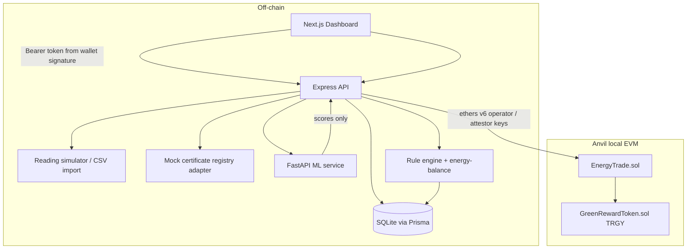
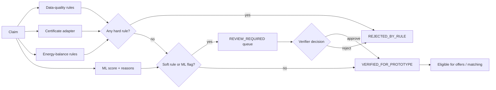
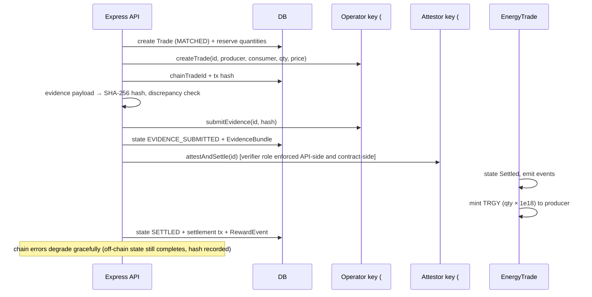

# Tranergy AI — Architecture

## Components and trust boundaries



### Trust rules

1. **Device data is not automatically trustworthy.** Every reading carries meter identity, unit, interval, ingestion time, source status, and quality status. Authorization status (`authorized | unverified | revoked`) is part of the rule engine.
2. **ML is advisory.** The Isolation Forest returns an anomaly score, model version, and reason codes. Deterministic rules and/or a human verifier decide workflow state. `automatedFraudFinding`-style claims are never made.
3. **Blockchain does not validate off-chain truth.** It makes submitted evidence hashes and state transitions tamper-evident after submission.
4. **Raw telemetry stays off-chain.** On-chain: trade IDs, participants, quantities, prices, state transitions, evidence hashes, settlement attestation, reward events.

## Verification pipeline



- **Hard rules** (immediate rejection): missing generation readings, invalid/negative readings, `CERTIFICATE_INVALID`, capacity ratio > 1.25.
- **Soft rules** (review queue): certificate transferred/retired/unknown/duplicate-use/quantity-too-small, capacity ratio > 1.05, claim > meter × 1.02, unauthorized meter source, stale reading (> 48 h), gaps, energy-balance residual > max(1, 5 %), ML flag.
- Only `VERIFIED_FOR_PROTOTYPE` intervals can create offers, and offerable quantity is recomputed at offer time.

## Energy balance (per interval, consistent units)

```
generation + import + batteryDischarge = load + export + batteryCharge + losses
estimatedSurplus = max(0, generation − load − batteryCharge)     # no-battery: gen − load
offerable       = max(0, estimatedSurplus − reserved − buffer)   # capped by export limit
                 = 0 unless a VERIFIED_FOR_PROTOTYPE claim covers the interval
```

`estimatedSurplus`, `offerable`, and measured `export` are always displayed separately; missing measurements make the result an estimate with visible assumptions.

## Matching (deterministic, explainable)

1. Group OPEN offers/requests by exact interval.
2. Exclude offers whose claim lost verification.
3. Offers sorted by price ascending; requests by max price descending.
4. Allocate `min(remaining offer, remaining request)` while `offerPrice ≤ maxPrice`.
5. Reservation via conditional SQL update (`reserved + qty <= quantity`) inside the transaction — double allocation is impossible.
6. Trade created `MATCHED`; physical delivery is *not* implied until evidence + attestation.

## Settlement pipeline



## Authorization model

- **API:** wallet signature → nonce → HMAC bearer token → server-side role checks (`producer`, `consumer`, `verifier`, `admin`; `coordinator` remains accepted for legacy tests). Self-verification of claims and self-settlement of trades are impossible without the verifier role.
- **Contract:** `OPERATOR_ROLE` (create/submit evidence) vs `ATTESTOR_ROLE` (settle/dispute) — the settlement path requires a second, distinct key even if the backend is compromised.
- **Keys:** Anvil dev keys #0/#1, public and local-only.

## Failure modes handled

| Failure | Behavior |
|---|---|
| ML service down | Claims verify with `mlStatus: UNAVAILABLE`; rules still apply; no crash |
| Chain disabled / RPC down | Full off-chain workflow; null tx hashes; `chainDisabled: true` noted; status endpoint explains why |
| Transient nonce race on Anvil | One retry with fresh nonce on send |
| Evidence discrepancy > tolerance | Trade → `REVIEW_REQUIRED` instead of settlement |
| Concurrent matching | Conditional reservation SQL prevents over-allocation |
