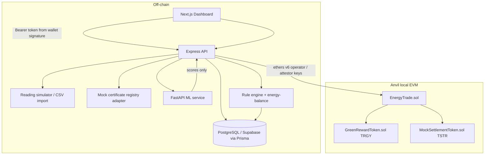
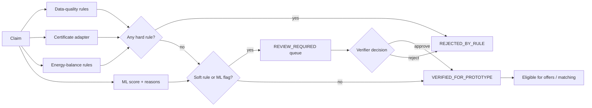

# Tranergy AI — Architecture

## Components and trust boundaries



### Trust rules

1. **Device data is not automatically trustworthy.** Every reading carries meter identity, unit, interval, ingestion time, source status, and quality status. Authorization status (`authorized | unverified | revoked`) is part of the rule engine.
2. **ML is advisory.** The Isolation Forest returns an anomaly score, model version, and reason codes. Deterministic rules and/or a human verifier decide workflow state. `automatedFraudFinding`-style claims are never made.
3. **Blockchain does not validate off-chain truth.** It makes submitted evidence hashes and state transitions tamper-evident after submission.
4. **Raw telemetry stays off-chain.** On-chain: trade IDs, participants, quantities, prices, token amounts, state transitions, evidence hashes, escrow deposits/settlement, reward events.
5. **Escrow money movement is chain-authoritative.** The API never marks a funded escrow trade `SETTLED` unless the contract reports the matching outcome; failed writes return `503` and leave the DB unchanged for a safe retry.

## Verification pipeline



- **Hard rules** (immediate rejection): missing generation readings, invalid/negative readings, `CERTIFICATE_INVALID`, capacity ratio > 1.25.
- **Soft rules** (review queue): certificate transferred/retired/unknown/duplicate-use/quantity-too-small, capacity ratio > 1.05, claim > meter × 1.02, unauthorized meter source, stale reading (> 48 h), gaps, energy-balance residual > max(1, 5 %), ML flag.
- Only `VERIFIED_FOR_PROTOTYPE` intervals can create offers, and offerable quantity is recomputed at offer time.

## Energy balance (per interval, consistent units)

```
generation + import + batteryDischarge = load + export + batteryCharge + losses
estimatedSurplus = max(0, generation − load − batteryCharge)     # no-battery: gen − load
offerable       = max(0, estimatedSurplus − reserved − buffer)   # capped by export limit
                 = 0 unless a VERIFIED_FOR_PROTOTYPE claim covers the interval
```

`estimatedSurplus`, `offerable`, and measured `export` are always displayed separately; missing measurements make the result an estimate with visible assumptions.

## Matching (deterministic, explainable)

1. Group OPEN offers/requests by exact interval.
2. Exclude offers whose claim lost verification.
3. Offers sorted by price ascending; requests by max price descending.
4. Allocate `min(remaining offer, remaining request)` while `offerPrice ≤ maxPrice`.
5. Reservation via conditional SQL update (`reserved + qty <= quantity`) inside the transaction — double allocation is impossible.
6. Trade created `MATCHED`; physical delivery is *not* implied until evidence + attestation.

## Settlement pipeline (mutual escrow)

```mermaid
sequenceDiagram
    participant C as Consumer wallet
    participant P as Producer wallet
    participant API as Express API
    participant DB
    participant OP as Operator key (#0)
    participant AT as Attestor key (#1)
    participant SC as EnergyTrade
    participant ST as TSTR ERC-20
    API->>DB: create Trade (MATCHED) + reserve quantities
    API->>OP: createEscrowTrade(id, producer, consumer, qtyMilli, priceUnits, fundingDeadline, deliveryDeadline)
    API->>DB: escrow quote, chainTradeId, deadlines, tx hash
    C->>ST: approve(EnergyTrade, payment + consumer collateral)
    C->>SC: depositConsumerPayment(id) + depositConsumerCollateral(id)
    P->>ST: approve(EnergyTrade, producer collateral)
    P->>SC: depositProducerCollateral(id)
    SC->>SC: all three funded → DeliveryActive
    API->>OP: submitEvidence(id, evidenceHash)  [after off-chain tolerance check]
    API->>AT: attestAndSettle / attestPartialDelivery / resolveProducerDefault / resolveDispute
    SC->>ST: pay producer, refund consumer, return/slash collateral
    SC->>SC: mint TRGY for verified delivery (full or partial), set outcome
    API->>DB: reconcile escrow snapshot, tx hashes, RewardEvent, evidence attestation
    Note over API: escrow-intended deployments refuse off-chain settlement;<br/>failed chain writes leave DB unchanged and return 503
    Note over C,SC: Unfunded escrow after fundingDeadline → cancelExpiredEscrow refunds all deposits
```

Escrow terms are snapshotted per trade: 6-decimal settlement token, integer `quantityKwhMilli`, `pricePerKwhUnits`, `tradeValue = mulDiv(quantityMilli, priceUnits, 1000)`, collateral ratio (`ESCROW_COLLATERAL_RATIO_BPS`, default 100%), and grace period (`ESCROW_DEFAULT_GRACE_PERIOD`, default 1 day). The contract conserves every unit: full delivery returns both collaterals; partial delivery splits payment and slashes the producer shortfall; producer default refunds payment + consumer collateral and slashes producer collateral. Consumer collateral is always returned because consumer performance is not enforceable by this contract.

Legacy non-escrow trades (`CHAIN_ENABLED=false`, or deployments without a settlement token) retain the old single-transaction path for local tests and demos.

## Authorization model

- **API:** wallet signature → nonce → HMAC bearer token → server-side role checks (`producer`, `consumer`, `verifier`, `admin`; `coordinator` remains accepted for legacy tests). Self-verification of claims and self-settlement of trades are impossible without the verifier role. Escrow deposits are accepted only from the assigned participant whose wallet matches the on-chain payer, and only after verifying the deposit event.
- **Contract:** `OPERATOR_ROLE` (create trades / register escrow / submit evidence / cancel expired escrow) vs `ATTESTOR_ROLE` (settle, partial settle, default, dispute resolution) — settlement requires a second, distinct key even if the backend is compromised. Participants themselves sign deposits and disputes.
- **Keys:** Anvil dev keys #0/#1, public and local-only.

## Failure modes handled

| Failure | Behavior |
|---|---|
| ML service down | Claims verify with `mlStatus: UNAVAILABLE`; rules still apply; no crash |
| Chain disabled / RPC down, escrow not intended | Legacy off-chain workflow; null tx hashes; `chainDisabled: true` noted; status endpoint explains why |
| Chain/RPC down, escrow intended | Matching refuses to create trades; escrow actions return `503 CHAIN_ERROR`; the DB is not advanced and tx hashes remain retryable |
| Transient nonce race on Anvil | One retry with fresh nonce on send |
| Evidence discrepancy > tolerance | Trade → `REVIEW_REQUIRED` instead of settlement; no on-chain evidence write |
| Partial delivery | Pro-rata payment + producer shortfall slashed; both collaterals returned in the remainder |
| Producer default after deadline + grace | Consumer refunded (payment + consumer collateral); producer collateral slashed |
| Unfunded escrow after funding deadline | Permissionless cancellation refunds consumer and producer deposits |
| Concurrent matching | Conditional reservation SQL prevents over-allocation |
