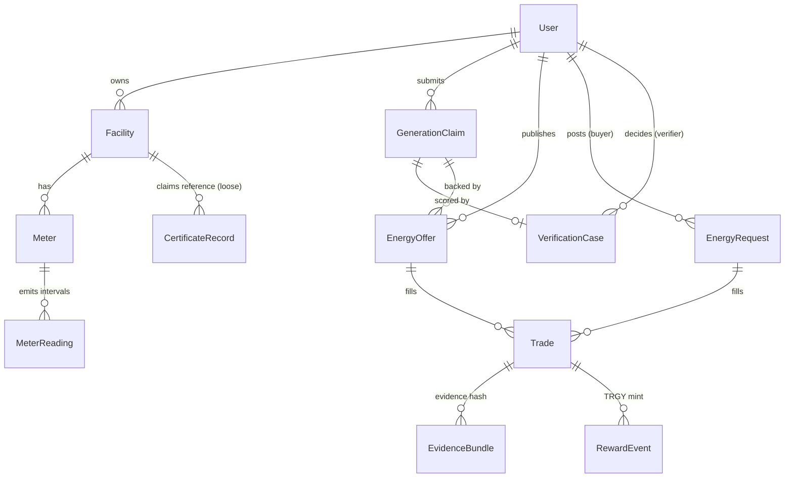

# Tranergy AI — Data Model

Canonical schema: `services/api/prisma/schema.prisma` (SQLite for the MVP; field names are PostgreSQL-portable).
API-facing shapes: [`api-spec.md`](api-spec.md).

## Entity map

## Tables (summary)

| Table | Purpose | Key fields / constraints |
|---|---|---|
| `User` | Identities + roles | `role` ∈ producer/ consumer/ verifier/ admin (`coordinator` legacy); `walletAddress` unique |
| `Facility` | Producer/consumer/storage sites | `installedCapacityKw`, `exportLimitKw`, `ownerId` |
| `Meter` | Virtual meters | `meterType`, `sourceType`, `sourceStatus` (authorized/unverified/revoked) |
| `MeterReading` | Interval energy (kWh) | **UNIQUE(meterId, intervalStart, intervalEnd)** — duplicate ingestion impossible; `qualityStatus` |
| `CertificateRecord` | Mock registry rows | **UNIQUE(externalId)**; `status` ∈ ACTIVE/TRANSFERRED/RETIRED/INVALID/UNKNOWN; `metadataHash` |
| `GenerationClaim` | Claimed generation per interval | `claimedKwh`, `certificateExternalId`, `status` ∈ PENDING/VERIFIED_FOR_PROTOTYPE/REVIEW_REQUIRED/REJECTED_BY_RULE |
| `VerificationCase` | One per claim (UNIQUE) | `ruleResults` JSON, `anomalyScore`, `anomalyFlags`, `modelVersion`, `reviewStatus`, reviewer decision audit |
| `EnergyOffer` | Sell-side, interval-bound | `quantityKwh`, `reservedKwh ≤ quantityKwh`, `pricePerKwh`, `status`, FK to claim (verification gate) |
| `EnergyRequest` | Buy-side, interval-bound | `quantityKwh`, `allocatedKwh`, `maxPricePerKwh` |
| `Trade` | Matched allocation | `agreedKwh`, `state` ∈ MATCHED/EVIDENCE_SUBMITTED/REVIEW_REQUIRED/DISPUTED/SETTLED; `evidenceHash`; `chainTradeId` (Int ≤ 1e9); `chainTxHash`, `settlementTxHash` |
| `EvidenceBundle` | Delivery evidence per trade | canonical payload refs + SHA-256 `evidenceHash`, `attestationStatus` |
| `RewardEvent` | TRGY mint record | `amount` decimal-string wei, recipient, settlement tx |

## Immutability & sync notes

- Certificate `externalId` and DB trade IDs are stable references used in evidence hashes and chain calls.
- `MeterReading` and `CertificateRecord` are treated as append/update-from-source records; the API never silently rewrites readings (duplicates are skipped and counted).
- On-chain data is a projection of DB state, not the reverse: DB drives writes; `getStateOnChain` is used for receipts/verification displays.
- ML artifacts (`modelVersion`, `anomalyScore`, reason codes) are stored on `VerificationCase` so historical decisions remain explainable after model retraining.
