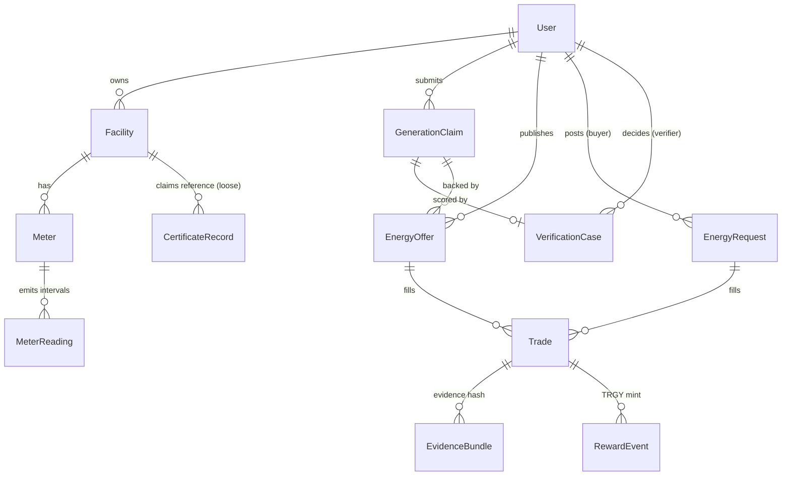

# Tranergy AI — Data Model

Canonical schema: `services/api/prisma/schema.prisma` (PostgreSQL/Supabase; `supabase-schema.sql` mirrors the DDL).
API-facing shapes: [`api-spec.md`](api-spec.md).

## Entity map

## Tables (summary)

| Table | Purpose | Key fields / constraints |
|---|---|---|
| `User` | Identities + roles | `role` ∈ producer/ consumer/ verifier/ admin (`coordinator` legacy); `walletAddress` unique |
| `Facility` | Producer/consumer/storage sites | `installedCapacityKw`, `exportLimitKw`, `ownerId` |
| `Meter` | Virtual meters | `meterType`, `sourceType`, `sourceStatus` (authorized/unverified/revoked) |
| `MeterReading` | Interval energy (kWh) | **UNIQUE(meterId, intervalStart, intervalEnd)** — duplicate ingestion impossible; `qualityStatus` |
| `CertificateRecord` | Mock registry rows | **UNIQUE(externalId)**; `status` ∈ ACTIVE/TRANSFERRED/RETIRED/INVALID/UNKNOWN; `metadataHash` |
| `GenerationClaim` | Claimed generation per interval | `claimedKwh`, `certificateExternalId`, `status` ∈ PENDING/VERIFIED_FOR_PROTOTYPE/REVIEW_REQUIRED/REJECTED_BY_RULE |
| `VerificationCase` | One per claim (UNIQUE) | `ruleResults` JSON, `anomalyScore`, `anomalyFlags`, `modelVersion`, `reviewStatus`, reviewer decision audit |
| `EnergyOffer` | Sell-side, interval-bound | `quantityKwh`, `reservedKwh ≤ quantityKwh`, `pricePerKwh`, `status`, FK to claim (verification gate) |
| `EnergyRequest` | Buy-side, interval-bound | `quantityKwh`, `allocatedKwh`, `maxPricePerKwh` |
| `Trade` | Matched allocation + escrow projection | `agreedKwh`, `state` ∈ MATCHED/DELIVERY_ACTIVE/EVIDENCE_SUBMITTED/REVIEW_REQUIRED/DISPUTED/SETTLED/PARTIALLY_SETTLED/DEFAULTED/CANCELLED; `evidenceHash`; `chainTradeId` (Int ≤ 1e9); `chainTxHash`, `settlementTxHash`; escrow fields below |
| `EvidenceBundle` | Delivery evidence per trade | canonical payload refs + SHA-256 `evidenceHash`, `attestationStatus` |
| `RewardEvent` | TRGY mint record | `amount` decimal-string wei, recipient, reason (`verified-delivery` or `verified-partial-delivery`), settlement tx |

### Trade escrow columns

| Group | Fields | Meaning |
|---|---|---|
| Flags | `escrowEnabled`, `escrowRequired`, `escrowState` | Whether the escrow was registered; whether the deployment required it; projected chain state (incl. `UNAVAILABLE`) |
| Token | `settlementToken`, `settlementTokenSymbol`, `settlementTokenDecimals` | Snapshot of the ERC-20 used for this trade (TSTR = 6 decimals in the demo) |
| Quote | `pricePerKwhUnits`, `tradeValueUnits`, `consumerPaymentUnits`, `consumerCollateralUnits`, `producerCollateralUnits`, `collateralRatioBps` | Integer base-unit amounts computed at registration |
| Funding | `consumerPaymentFundedUnits`, `consumerCollateralFundedUnits`, `producerCollateralFundedUnits`, `consumerPaymentTxHash`, `consumerCollateralTxHash`, `producerCollateralTxHash`, `fundingActivationTxHash`, `fundedAt` | Per-kind deposits and activation tx |
| Clock | `fundingDeadline`, `deliveryDeadline`, `deliveryGracePeriodSeconds` | Deadlines enforced by the contract (stored for UI/API checks) |
| Verification | `verifiedDeliveredKwh`, `verifiedDeliveredKwhMilli`, `settlementOutcome` | Attested delivery quantity and outcome (FULL_DELIVERY / PARTIAL_DELIVERY / PRODUCER_DEFAULT / CANCELLED) |
| Settlement | `paymentToProducerUnits`, `paymentRefundedUnits`, `producerCollateralReturnedUnits`, `producerCollateralSlashedUnits`, `consumerCollateralReturnedUnits`, `finalSettlementTxHash`, `resolvedAt` | Token flow projection for receipts |
| Dispute | `disputeRaisedBy`, `disputeReason`, `disputeTxHash`, `disputeResolutionOutcome`, `disputeResolutionReason`, `disputeResolutionEvidenceHash`, `disputeResolutionTxHash` | Participant/verifier dispute audit trail |

Token amounts are stored as **decimal strings** (not floats) so 6-decimal base units and 18-decimal TRGY rewards round-trip exactly. The chain remains authoritative for escrow money movement; the DB is reconciled by `syncEscrowTrade`/`GET /trades/:id` and is never advanced to a settled state unless the contract reports the same outcome.

## Immutability & sync notes

- Certificate `externalId` and DB trade IDs are stable references used in evidence hashes and chain calls.
- `MeterReading` and `CertificateRecord` are treated as append/update-from-source records; the API never silently rewrites readings (duplicates are skipped and counted).
- On-chain escrow state is authoritative for money movement. The DB is reconciled **from** `getEscrow`/`getTrade` after every successful write and on live reads; a failed chain write leaves the DB unchanged so the action can be retried.
- Legacy (non-escrow) trades still project DB-driven settlement; escrow trades never fall back to off-chain settlement.
- ML artifacts (`modelVersion`, `anomalyScore`, reason codes) are stored on `VerificationCase` so historical decisions remain explainable after model retraining.
